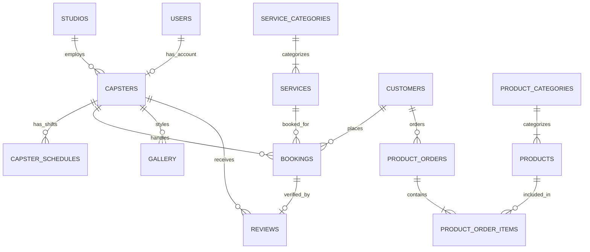

# 💈 South Hair Studio — Dokumentasi Database Lengkap

Database resmi untuk website **South Hair Studio** (Barbershop Presisi & Gaya Matang • Kota Palopo). Dirancang secara relasional, normalisasi 3NF, terindeks, dan siap digunakan baik untuk sistem lokal (SQLite) maupun server produksi (MySQL, MariaDB, PostgreSQL).

---

## 📁 File Database yang Tersedia

1. **[`south_hair_studio.db`](file:///d:/Coding/south_hair_studio/database/south_hair_studio.db)**: File database SQLite aktif yang sudah diinisialisasi dan diisi seluruh data asli South Hair Studio (siap langsung dipakai tanpa install server database).
2. **[`init_db.py`](file:///d:/Coding/south_hair_studio/database/init_db.py)**: Script Python untuk me-reset, membuat ulang tabel, dan melakukan *seeding* otomatis.
3. **[`schema.sql`](file:///d:/Coding/south_hair_studio/database/schema.sql)**: Skema universal standar ANSI SQL (kompatibel dengan SQLite, PostgreSQL, Supabase, Neon, dll).
5. **[`server.js`](file:///d:/Coding/south_hair_studio/server.js)**: Server REST API & file server (Node.js native `node:sqlite`).
6. **[`html/login.html`](file:///d:/Coding/south_hair_studio/html/login.html)**: Portal Login Admin & Kasir (`http://localhost:8080/login`).
7. **[`html/admin.html`](file:///d:/Coding/south_hair_studio/html/admin.html)**: Dashboard Manajemen Studio (`http://localhost:8080/admin`).

### 🔑 Akun Demo Login:
- **Owner / Superadmin**: Username `superadmin` / Password `admin123`
- **Kasir Front Desk**: Username `kasir` / Password `kasir123`

---

## 🗺️ Entity Relationship Diagram (ERD)



---

## 🗄️ Struktur Tabel (Data Dictionary)

### 1. `studios` (Profil & Pengaturan Barbershop)
Menyimpan informasi inti studio, kontak WhatsApp konfirmasi, jam operasional, dan lokasi.
- `id` (INT PK): ID unik studio.
- `name` (VARCHAR): Nama studio (`South Hair Studio`).
- `tagline` (VARCHAR): Slogan studio.
- `city` (VARCHAR): Kota operasional (`Kota Palopo`).
- `address` (TEXT): Alamat lengkap studio (`Jl. Andi Kambo, Surutanga, Wara Timur, Kota Palopo`).
- `phone`, `whatsapp` (VARCHAR): Nomor kontak WhatsApp kasir/pemilik (`082259972253`).
- `open_time`, `close_time` (TIME): Jam buka & tutup (`10:00:00` - `22:00:00 WITA`).
- `is_active` (BOOLEAN): Status buka/tutup toko.

### 2. `users` (Akun Staff & Manajemen)
Mengelola akses kasir, capster, dan admin studio.
- `id` (INT PK): ID user.
- `username` (VARCHAR UNIQUE): Username login.
- `password_hash` (VARCHAR): Password terenkripsi (Bcrypt/Argon2).
- `full_name` (VARCHAR): Nama lengkap staff.
- `role` (ENUM): `'superadmin'`, `'admin'`, `'cashier'`, `'barber'`.
- `is_active` (BOOLEAN): Status aktif akun.

### 3. `capsters` (Tim Barber / Capster)
Data profil barber yang tampil di 3D Carousel & sistem pemilihan capster.
- `id` (INT PK): ID capster.
- `user_id` (INT FK NULL): Relasi ke akun user kasir/capster.
- `slug` (VARCHAR UNIQUE): Slug URL (`ikmal`, `abi`, `rezky`).
- `name` (VARCHAR): Nama panggilan (`Ikmal`, `Abi`, `Rezky`).
- `full_name` (VARCHAR): Nama lengkap (`Muhammad Ikmal`, dll).
- `role_title` (VARCHAR): Jabatan (`Founder & Master Barber`, `Senior Barber`, dll).
- `badge` (VARCHAR): Tag styling (`FOUNDER & MASTER`, `CLASSIC & MODERN`, `TEXTURE & FADE`).
- `bio` (TEXT): Deskripsi keahlian dan riwayat barber.
- `photo_url` (VARCHAR): Path foto poster (`assets/capster_south/abi.png`).
- `booking_value` (VARCHAR UNIQUE): Nilai value formulir reservasi.
- `rating` (DECIMAL): Rata-rata rating bintang pelanggan (contoh: 5.0).
- `cuts_count` (INT): Total potongan yang telah diselesaikan.
- `status` (ENUM): `'active'`, `'off_duty'`, `'inactive'`.

### 4. `capster_schedules` (Jadwal Shift Kerja)
- `id` (INT PK)
- `capster_id` (INT FK -> `capsters.id`)
- `day_of_week` (TINYINT): Hari (0=Minggu, 1=Senin, s/d 6=Sabtu).
- `start_time`, `end_time` (TIME): Jam shift kerja.
- `is_day_off` (BOOLEAN): Penanda hari libur.

### 5. `services` & `service_categories` (Katalog Layanan & Tarif)
Menampung seluruh daftar treatment barbershop.
- Data Seed:
  1. **Hair Cut** — Rp 40.000
  2. **Highlight Color** — Rp 150.000
  3. **Full Color** — Rp 130.000
  4. **Perming** — Rp 180.000
  5. **Down Perm** — Rp 75.000

### 6. `customers` (Database Pelanggan)
- `id` (INT PK)
- `name` (VARCHAR): Nama pelanggan.
- `phone` (VARCHAR UNIQUE): Nomor WhatsApp pelanggan (kunci unik rekam jejak riwayat booking).
- `total_bookings` (INT): Loyalitas kunjungan.
- `last_visit_at` (DATETIME): Tanggal terakhir cukur di studio.

### 7. `bookings` (Reservasi Kursi & Tiket Antrian)
Tabel transaksi utama untuk alur booking online:
- `booking_code` (VARCHAR UNIQUE): Kode tiket unik (contoh: `SHS-20261025-001`).
- `customer_name`, `customer_phone` (VARCHAR).
- `service_id` (INT FK -> `services.id`).
- `capster_id` (INT FK -> `capsters.id`).
- `booking_date` (DATE) & `booking_time` (TIME).
- `total_amount` (DECIMAL): Total tagihan.
- `status` (ENUM): `'pending'`, `'confirmed'`, `'in_progress'`, `'completed'`, `'cancelled'`.
- `whatsapp_notified` (BOOLEAN): Status pengiriman notifikasi ke WhatsApp studio.

### 8. `products` & `product_categories` (Katalog Produk Retail Grooming)
- Data Seed:
  1. **Matte Clay Pomade** — Rp 85.000 (Stok: 24, Berat: 100 gr)
  2. **Texture Hair Powder** — Rp 65.000 (Stok: 35, Berat: 10 gr)
  3. **Kurl Defining Cream** — Rp 95.000 (Stok: 18, Volume: 150 ml)
- Lengkap dengan `benefits`, `how_to_use`, dan `ingredients`.

### 9. `product_orders` & `product_order_items` (Transaksi Pembelian Produk)
- `order_code` (VARCHAR UNIQUE): Kode pemesanan (`ORD-XXXXX`).
- `delivery_type` (ENUM): `'pickup_studio'` (ambil di studio) atau `'delivery_palopo'` (antar ke alamat Palopo).
- Relasi item belanja detail ke produk yang dibeli beserta kuantitas & harga satuan.

### 10. `gallery` (Portofolio Model Potongan Rambut)
Menyimpan foto hasil potongan rambut (WARRIORCUT, FRINGE, TEXTURE, FADE, TAPER FADE, dll).

### 11. `reviews` (Testimoni & Rating)
Menampung ulasan pelanggan terverifikasi yang ditampilkan pada halaman publik.

---

## 🚀 Cara Menjalankan & Menggunakan

### Opsi A: Menggunakan SQLite (Lokal / Node.js / Python Langsung Siap)
Database sudah dibuat di:
```text
database/south_hair_studio.db
```
Jika ingin mereset atau mengisi ulang data kapan saja:
```bash
python database/init_db.py
```

### Opsi B: Import ke MySQL / MariaDB (phpMyAdmin / cPanel / Laragon)
1. Buka **phpMyAdmin** atau console MySQL.
2. Buat database baru bernama: `south_hair_studio`.
3. Klik tab **Import** dan pilih file:
   [`database/schema_mysql.sql`](file:///d:/Coding/south_hair_studio/database/schema_mysql.sql).
4. Klik **Go / Kirim**. Seluruh 14 tabel beserta data awal otomatis terpasang.

---

## 🔍 Contoh Query Bisnis Barbershop

### 1. Menampilkan Jadwal Booking Hari Ini Lengkap dengan Barber & Layanan:
```sql
SELECT 
    b.booking_code,
    b.booking_time,
    b.customer_name,
    b.customer_phone,
    s.name AS service_name,
    s.price AS service_price,
    c.name AS capster_name,
    b.status
FROM bookings b
JOIN services s ON b.service_id = s.id
JOIN capsters c ON b.capster_id = c.id
WHERE b.booking_date = CURRENT_DATE
ORDER BY b.booking_time ASC;
```

### 2. Rekap Omset & Total Potongan per Capster Bulan Ini:
```sql
SELECT 
    c.name AS capster_name,
    COUNT(b.id) AS total_cuts,
    SUM(b.total_amount) AS total_revenue
FROM capsters c
LEFT JOIN bookings b ON c.id = b.capster_id AND b.status = 'completed'
GROUP BY c.id, c.name
ORDER BY total_revenue DESC;
```

### 3. Cek Stok Produk yang Menipis (< 10 pcs):
```sql
SELECT id, name, stock, price 
FROM products 
WHERE stock < 10 AND is_active = 1;
```
